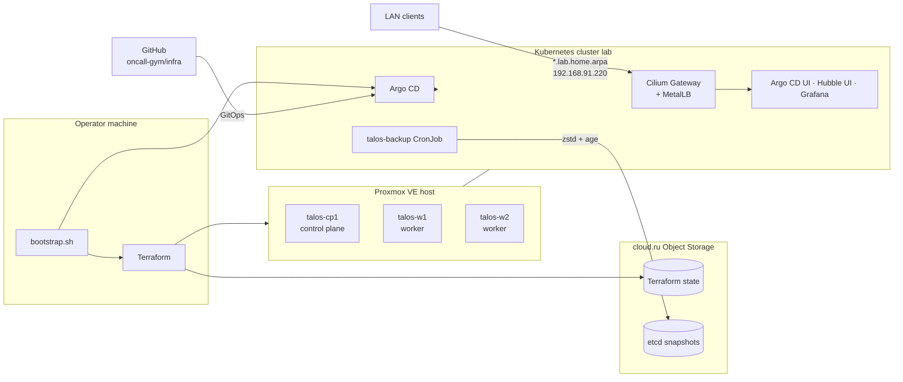

# infra

Infrastructure for a hands-on DevOps troubleshooting trainer: a three-node Kubernetes lab on a single Proxmox host, built the way a production platform would be.

## What this is

The trainer gives a player a live, deliberately broken environment and asks them to fix it with real tools. This repository is the platform those labs run on. The trainer itself (the API and the scenarios) lives in [oncall-gym/trainer](https://github.com/oncall-gym/trainer).

The whole lab is code. One script brings it up from an empty Proxmox host: Terraform creates the VMs and the Talos cluster, and then Argo CD installs everything else from this repository. Secrets are encrypted in Git, the CA survives re-creation of the cluster, and etcd is backed up off-site with a restore procedure that has actually been drilled.

## Architecture



## Stack

| Layer | Choice | Version |
| --- | --- | --- |
| Virtualization | Proxmox VE | 9.2.21 |
| Node OS | Talos Linux (immutable, API-managed) | v1.14.2 |
| Kubernetes | 1 control plane, 2 workers | v1.37.0 |
| Provisioning | Terraform with `bpg/proxmox` and `siderolabs/talos` | Terraform 1.16, providers 0.115.0 / 0.12.0 |
| Terraform state, backups | cloud.ru Object Storage (S3-compatible) | – |
| CNI | Cilium with kube-proxy replacement and Hubble | 1.20.2 |
| GitOps | Argo CD, app of apps, GitHub login through Dex | 3.5.3 |
| Load balancing | MetalLB, L2 mode | 0.16.1 |
| Ingress | Gateway API implemented by Cilium | 1.6.1 |
| Certificates | cert-manager with an in-cluster CA | 1.21.2 |
| Secrets in Git | SOPS + age, sops-secrets-operator | 0.21.2 |
| Monitoring | victoria-metrics-k8s-stack: VictoriaMetrics, Alertmanager, Grafana | chart 0.95.2 |
| etcd backup | talos-backup | v0.1.0-beta.3 |

## Repository layout

```
main.tf, variables.tf, ...   Terraform: Proxmox VMs and the Talos cluster
cloud/                       Terraform: S3 buckets for state and etcd backups
bootstrap.sh                 brings the cluster up from scratch
gitops/root.yaml             Argo CD root application
gitops/apps/                 one Argo CD Application per component
gitops/<component>/          manifests and Helm values for those applications
gitops/secrets/              SOPS-encrypted secrets
docs/                        component notes and runbooks
```

## Design notes

- **Least privilege for backups.** The backup job talks to the Talos API from inside the cluster. Talos allows that only for pods in the `talos-backup` namespace and only with the `os:etcd:backup` role: the job can take a snapshot and nothing else.
- **Backups the cluster cannot read.** Snapshots are encrypted with a dedicated age key whose private half is not in the cluster, so access to the cluster or to the bucket is not enough to read them. The job's S3 keys can upload snapshots but cannot list or download them, and have no access to the Terraform state bucket. The bucket uses Object Lock in `GOVERNANCE` mode: for 14 days a snapshot cannot be deleted or overwritten, while an administrator can still lift the lock in an emergency.
- **Restore is tested, not assumed.** A drill wiped etcd on the control plane and restored it from S3: the control plane was back in 5 minutes. The drill found a non-obvious failure (Cilium agents on workers lose the API server address and need a restart), which is now part of the [runbook](docs/runbooks/etcd-restore.md).
- **Bootstrap order matters.** The Gateway API CRDs are installed before Cilium, because the Cilium operator creates its `GatewayClass` only if the CRDs exist when it starts. After the first install, `bootstrap.sh` hands Cilium and Argo CD over to Argo CD and never touches them again, so re-running the script on a live cluster is safe.
- **Stable trust across rebuilds.** The CA private key is carried over by `bootstrap.sh` when the cluster is re-created, so client machines keep trusting `*.lab.home.arpa` certificates.
- **No plaintext secrets in Git.** Secrets are `SopsSecret` objects with only the secret fields encrypted, so names and namespaces stay reviewable in diffs. The local `admin` account of Argo CD is disabled; access is granted to a GitHub team, not to individuals.
- **Working around a non-AWS S3.** cloud.ru has no STS, IAM or instance metadata, and its lifecycle API does not return the fields the AWS provider waits for. The provider checks are switched off and the lifecycle rule is applied through the AWS CLI from Terraform.
- **Fits a small budget.** All three VMs share 12 vCPU and 16 GB of RAM: VictoriaMetrics instead of Prometheus, a single-replica Cilium operator, no Argo CD notifications controller.

## Getting started

Requirements: a Proxmox host with the Talos ISO uploaded, `terraform`, `kubectl`, `helm`, `jq`, an S3 bucket for the state, a Proxmox API token, the deploy key for this repository and the age key for the secrets. The full list is in [docs/bootstrap.md](docs/bootstrap.md).

```sh
terraform init
./bootstrap.sh
kubectl --kubeconfig ./kubeconfig -n argocd get applications
```

When all applications are `Synced` and `Healthy`, Argo CD, Hubble UI and Grafana are served at `https://{argocd,hubble,grafana}.lab.home.arpa`.

## Documentation

| Document | Covers |
| --- | --- |
| [docs/provisioning.md](docs/provisioning.md) | Proxmox VMs, Talos configuration, Terraform state, S3 buckets, local environment |
| [docs/bootstrap.md](docs/bootstrap.md) | what `bootstrap.sh` does and what it needs |
| [docs/gitops.md](docs/gitops.md) | Argo CD, application layout, GitHub login and permissions |
| [docs/networking.md](docs/networking.md) | Cilium, MetalLB, the shared gateway, publishing a service |
| [docs/certificates.md](docs/certificates.md) | the lab CA and trust on client machines |
| [docs/secrets.md](docs/secrets.md) | working with SOPS-encrypted secrets |
| [docs/monitoring.md](docs/monitoring.md) | metrics, alerts and Grafana |
| [docs/backup.md](docs/backup.md) | etcd backups |
| [docs/runbooks/etcd-restore.md](docs/runbooks/etcd-restore.md) | restoring etcd from a snapshot |

## Open questions

- Persistent storage in the cluster: there is none yet, so metrics live in `emptyDir`.
- Log collection.
- How the trainer starts and resets scenarios.
- The final split of CPU and memory between the VMs.
